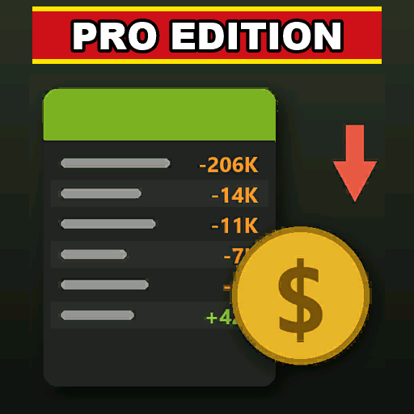

# ModHub upload: Monthly Expense Sheet Pro Edition

What to enter in the GIANTS ModHub upload form for this mod. Each text box below has a copy button on GitHub.



**Mod Icon (512x512):** [`icon_512.png`](icon_512.png)

| Field | Value |
|-------|-------|
| Title English | Monthly Expense Sheet Pro Edition |
| Title German | Monatliche Ausgabenübersicht Pro Edition |
| Title French | Relevé mensuel des dépenses Pro Edition |
| Version | `0` `2` `2` `1` |
| Author | DTM Mods, PropaineX |
| Manufacturer | Lizard |
| Category 1 | Gameplay |
| Category 2 | Not Set |
| Category 3 | Not Set |

## Title English
```text
Monthly Expense Sheet Pro Edition
```

## Title German
```text
Monatliche Ausgabenübersicht Pro Edition
```

## Title French
```text
Relevé mensuel des dépenses Pro Edition
```

## Description English
```text
Description: Keeps a record of every money change on your farm and sorts it by month and category, so you can see where your money went.
Hotkeys: Left Alt+M opens and closes the sheet. In the sheet: Q / E previous / next month, Up / Down select a category, Left / Right switch between expenses and income, the mouse wheel scrolls the details, Esc closes. Controller: none by default for opening the sheet, set one under Settings > Controls; in the sheet the controller's menu buttons work as well.
GitHub: https://github.com/DTM-Mods/FS25_MonthlyExpenseSheet

It records the same money changes that pop up under your balance in the top right corner. Money that changes without a popup is caught too and listed as "Untracked balance changes", so the sheet always adds up to what happened to your balance.

Expenses and income are listed by category with the number of charges, the month's total and last month's total. Select a category to see every single charge with its date and time.

The records are saved with your savegame (the last 24 months). Works in multiplayer: the server keeps the records, each player sees their own farm.
```

## Description German
```text
Beschreibung: Zeichnet jede Geldbewegung auf deinem Hof auf und sortiert sie nach Monat und Kategorie, damit du siehst, wohin dein Geld gegangen ist.
Tastenkombinationen: Linke Alt-Taste+M öffnet und schließt die Aufstellung. In der Aufstellung: Q / E vorheriger / nächster Monat, Hoch / Runter Kategorie auswählen, Links / Rechts zwischen Ausgaben und Einnahmen wechseln, das Mausrad scrollt die Details, Esc schließt. Controller: zum Öffnen standardmäßig keine Belegung, unter Einstellungen > Steuerung festlegen; in der Aufstellung funktionieren auch die Menütasten des Controllers.
GitHub: https://github.com/DTM-Mods/FS25_MonthlyExpenseSheet

Aufgezeichnet werden genau die Geldbewegungen, die oben rechts unter deinem Kontostand eingeblendet werden. Geld, das sich ohne Einblendung ändert, wird ebenfalls erfasst und als "Untracked balance changes" aufgeführt, sodass die Aufstellung immer genau dem entspricht, was mit deinem Kontostand passiert ist.

Ausgaben und Einnahmen werden nach Kategorie aufgelistet, mit der Anzahl der Buchungen, der Summe des Monats und der Summe des Vormonats. Wähle eine Kategorie aus, um jede einzelne Buchung mit Datum und Uhrzeit zu sehen.

Die Aufzeichnungen werden mit deinem Spielstand gespeichert (die letzten 24 Monate). Funktioniert im Mehrspielermodus: Der Server führt die Aufzeichnungen, jeder Spieler sieht seinen eigenen Hof.
```

## Description French
```text
Description : enregistre chaque mouvement d'argent de votre ferme et le trie par mois et par catégorie, pour voir où est passé votre argent.
Raccourcis clavier : Alt gauche+M ouvre et ferme le relevé. Dans le relevé : Q / E mois précédent / suivant, Haut / Bas choisir une catégorie, Gauche / Droite passer des dépenses aux revenus, la molette de la souris fait défiler les détails, Échap ferme. Manette : aucune touche par défaut pour ouvrir le relevé, à définir dans Paramètres > Commandes ; dans le relevé, les boutons de menu de la manette fonctionnent aussi.
GitHub : https://github.com/DTM-Mods/FS25_MonthlyExpenseSheet

Il enregistre les mêmes mouvements d'argent que ceux qui s'affichent sous votre solde en haut à droite. L'argent qui change sans message est aussi pris en compte et listé sous « Untracked balance changes », le relevé correspond donc toujours à ce qui est arrivé à votre solde.

Les dépenses et les revenus sont listés par catégorie avec le nombre d'opérations, le total du mois et celui du mois précédent. Choisissez une catégorie pour voir chaque opération avec sa date et son heure.

Les données sont enregistrées avec la sauvegarde (les 24 derniers mois). Fonctionne en multijoueur : le serveur conserve les données, chaque joueur voit sa propre ferme.
```

## Before uploading

- The mod itself is English only: modDesc has no German or French title or description, and its texts (the sheet, the key name) are English only. German and French players see the sheet in English, which is why "Sold Wheat" stays in English in the German and French descriptions. The texts here do not add translations to the mod.
