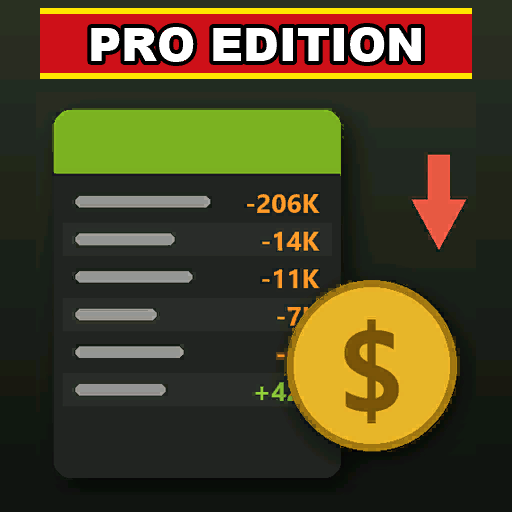

# ModHub upload: Monthly Expense Sheet Pro Edition

What to enter in the GIANTS ModHub upload form for this mod. Each text box below has a copy button on GitHub.



**Mod Icon (512x512):** [`icon_512.png`](icon_512.png)

| Field | Value |
|-------|-------|
| Title English | Monthly Expense Sheet Pro Edition |
| Title German | Monatliche Ausgabenübersicht Pro Edition |
| Title French | Relevé mensuel des dépenses Pro Edition |
| Version | `0` `2` `2` `1` |
| Author | DTM Mods, PropaineX |
| Manufacturer | Lizard |
| Category 1 | Gameplay |
| Category 2 | Not Set |
| Category 3 | Not Set |

## Title English
```text
Monthly Expense Sheet Pro Edition
```

## Title German
```text
Monatliche Ausgabenübersicht Pro Edition
```

## Title French
```text
Relevé mensuel des dépenses Pro Edition
```

## Description English
```text
When you sleep, the money popups under your balance in the top right corner scroll by too fast to read. This mod records every one of them and sorts them by in-game month, so you can see exactly where your money went. Money that changes without a popup is caught too, so the sheet always adds up to your balance.

- Every expense and income category of the month with the number of charges, the month's total and last month's total, with a red or green arrow for up or down.
- Every single charge in the selected category with its date and time.
- Total expenses, total income and the net for the month.
- Sales show what was sold, such as "Sold Wheat"; hourly income from generators, wind turbines and solar is listed per building.
- Money from other mods shows that mod's name or its own popup text.
- Records are saved with your savegame (last 24 months). In multiplayer the server keeps the records and each player sees their own farm.

How to use: Left Alt + M opens and closes the sheet. Q / E: previous / next month. Up / Down: select a category. Left / Right: expenses / income. The mouse works too.

Changelog 0.2.2.0:
- Money from other mods shows its real name instead of a text key.
- An unknown text key is shown as readable words instead of the raw key.
```

## Description German
```text
Wenn du schläfst, laufen die Geldmeldungen unter deinem Kontostand oben rechts zu schnell durch, um sie zu lesen. Diese Mod zeichnet jede einzelne auf und sortiert sie nach Spielmonat, so siehst du genau, wohin dein Geld gegangen ist. Auch Geld, das sich ohne Meldung ändert, wird erfasst, damit die Übersicht immer zu deinem Kontostand passt.

- Jede Ausgaben- und Einnahmenkategorie des Monats mit Anzahl der Buchungen, Monatssumme und Vormonatssumme, mit rotem oder grünem Pfeil für mehr oder weniger.
- Jede einzelne Buchung der gewählten Kategorie mit Datum und Uhrzeit.
- Gesamtausgaben, Gesamteinnahmen und das Monatsergebnis.
- Verkäufe zeigen, was verkauft wurde, etwa "Sold Wheat"; stündliche Einnahmen aus Generatoren, Windrädern und Solaranlagen stehen pro Gebäude.
- Geld aus anderen Mods zeigt den Namen der Mod oder ihren eigenen Meldungstext.
- Die Daten werden mit dem Spielstand gespeichert (die letzten 24 Monate). Im Mehrspieler speichert der Server die Daten und jeder Spieler sieht seinen eigenen Hof.

So geht's: Linke Alt + M öffnet und schließt die Übersicht. Q / E: vorheriger / nächster Monat. Hoch / Runter: Kategorie wählen. Links / Rechts: Ausgaben / Einnahmen. Die Maus geht auch.

Changelog 0.2.2.0:
- Geld aus anderen Mods zeigt seinen echten Namen statt eines Textschlüssels.
- Ein unbekannter Textschlüssel wird als lesbare Wörter statt als roher Schlüssel angezeigt.
```

## Description French
```text
Quand vous dormez, les messages d'argent sous votre solde en haut à droite défilent trop vite pour être lus. Ce mod enregistre chacun d'eux et les trie par mois de jeu, pour voir exactement où est passé votre argent. L'argent qui change sans message est aussi pris en compte, le relevé correspond donc toujours à votre solde.

- Chaque catégorie de dépenses et de revenus du mois avec le nombre d'opérations, le total du mois et celui du mois précédent, avec une flèche rouge ou verte pour la hausse ou la baisse.
- Chaque opération de la catégorie choisie avec sa date et son heure.
- Total des dépenses, total des revenus et le solde net du mois.
- Les ventes indiquent ce qui a été vendu, comme "Sold Wheat" ; les revenus horaires des générateurs, éoliennes et panneaux solaires sont listés par bâtiment.
- L'argent venant d'autres mods affiche le nom du mod ou son propre texte de message.
- Les données sont enregistrées avec la sauvegarde (les 24 derniers mois). En multijoueur, le serveur conserve les données et chaque joueur voit sa propre ferme.

Utilisation : Alt gauche + M ouvre et ferme le relevé. Q / E : mois précédent / suivant. Haut / Bas : choisir une catégorie. Gauche / Droite : dépenses / revenus. La souris fonctionne aussi.

Changelog 0.2.2.0 :
- L'argent venant d'autres mods affiche son vrai nom au lieu d'une clé de texte.
- Une clé de texte inconnue s'affiche en mots lisibles au lieu de la clé brute.
```

## Before uploading

- The mod itself is English only: modDesc has no German or French title or description, and its texts (the sheet, the key name) are English only. German and French players see the sheet in English, which is why "Sold Wheat" stays in English in the German and French descriptions. The texts here do not add translations to the mod.
